<!-- Terminal Header Banner -->

  

<!-- Live Animated Contribution Heatmap -->
<h3><code>shloka@github ~ $ ./contributions.sh</code></h3>

  

<!-- Whoami: Side-by-side ASCII Portrait & Neofetch Card -->
<h3><code>shloka@github ~ $ whoami --verbose</code></h3>

<table border="0">
  <tr>
    <td valign="top" width="420">
      
    </td>
    <td valign="top" width="440">
      
    </td>
  </tr>
</table>

  

<!-- Featured Projects -->
<h3><code>shloka@github ~ $ ./projects.sh --starred</code></h3>

<table border="0" width="860">
  <tr>
    <td width="50%" valign="top">
      <h4>🏆 <a href="https://github.com/sagusoky/AeroLab-8.swiftpm">AeroLab (iOS / Swift)</a></h4>
      
<b>Apple Swift Student Challenge 2026 Distinguished Winner (Top 50)</b> 
      Award-winning interactive aviation physics & flight mechanics application recognized internationally by Apple and invited to Apple Park, Cupertino.

      <code>Swift</code> · <code>SwiftUI</code> · <code>iOS</code> · <code>Physics Engine</code>
    </td>
    <td width="50%" valign="top">
      <h4>⚡ <a href="https://github.com/sagusoky/zomato-ai-data-pipeline">Zomato AI Data Pipeline</a></h4>
      
<b>Enterprise-scale data engineering pipeline</b> 
      Engineered scalable pipeline processing <b>33M+ records</b> using Snowflake, dbt, Apache Airflow, and Python with LLM sentiment & decision analytics.

      <code>Snowflake</code> · <code>dbt</code> · <code>Airflow</code> · <code>Python</code> · <code>LLM</code>
    </td>
  </tr>
  <tr>
    <td width="50%" valign="top">
      <h4>📊 <a href="https://github.com/sagusoky/PharmaPulse-Commercial-Analytics">PharmaPulse Commercial Analytics</a></h4>
      
<b>Commercial Analytics Case Study</b> 
      Analyzed 2,100+ sales records using Python, SQL, and Tableau. Built KPI models uncovering 15+ high-impact business insights.

      <code>Python</code> · <code>SQL</code> · <code>Tableau</code> · <code>EDA</code>
    </td>
    <td width="50%" valign="top">
      <h4>📱 <a href="https://github.com/sagusoky">Storeasy (iOS)</a></h4>
      
<b>Privacy-First On-Device iPhone Cleaner</b> 
      High-performance duplicate photo, screenshot, and contact management running 100% locally on-device with zero cloud dependencies.

      <code>Swift</code> · <code>PhotoKit</code> · <code>CoreData</code> · <code>iOS 17+</code>
    </td>
  </tr>
</table>

  

<!-- Tech Radar -->
<h3><code>shloka@github ~ $ ./skills.sh</code></h3>

  
  
  
  
  
  

  
  
  
  
  
  
  

  

<!-- Honors & Accolades -->
<h3><code>shloka@github ~ $ cat ~/accolades.log</code></h3>

<table border="0" width="860">
  <tr>
    <td align="left">
      <ul>
        <li>🏆 <b>International Top 50 Distinguished Winner</b> — Apple Swift Student Challenge 2026 (Invited to Apple Park, Cupertino)</li>
        <li>🎯 <b>Top 100 in India</b> — ZS Campus Beats Case Study Competition</li>
        <li>🎓 <b>B.Tech Computer Science &amp; Engineering</b> @ MIT World Peace University (8.82 CGPA)</li>
        <li>💼 <b>Consulting Job Simulations</b> — Completed BCG Strategy &amp; PwC Management Consulting programs</li>
        <li>🏢 <b>Industry Experience</b> — Omnevu Systems (App Development &amp; Risk) · Infosys (Retail Systems)</li>
      </ul>
    </td>
  </tr>
</table>

  

<!-- Connect / Links -->
<h3><code>shloka@github ~ $ ./connect.sh</code></h3>

  
  &nbsp;
  
  &nbsp;
  
  &nbsp;
  

 

⚡ Automated by Python &amp; GitHub Actions · Self-contained animated vector SVG

